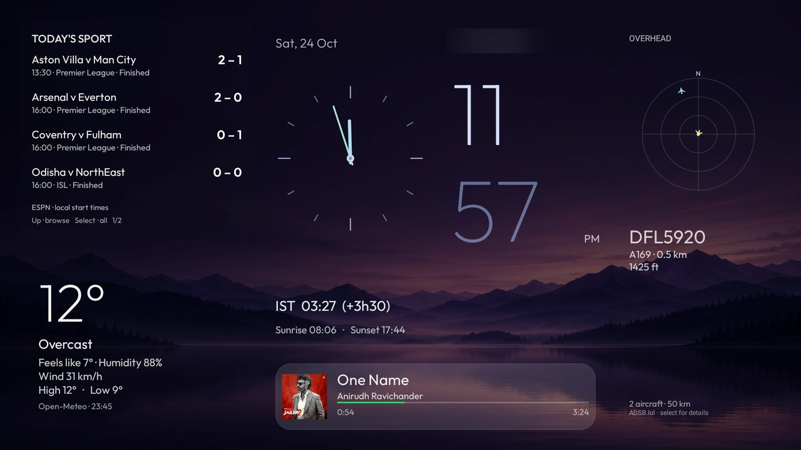

# Violet Horizon

A purple, widget-first Fire TV dashboard built on [Fire TV Glass](https://github.com/ivantrj/firetv-glass-launcher), developed while setting up a TV with [CleanYourTV](https://github.com/Gathin23/cleanyourtv).

**Tested:** Fire TV Stick Lite (2020), AFTSS / sheldon; Fire OS 7.7.1.7, firmware PS7717.5741N; Android 9 / SDK 28. Other models and firmware are unverified.



This **`violet-horizon` branch** contains the complete dashboard. The smaller offline compatibility contribution remains separate in [upstream PR #3](https://github.com/ivantrj/firetv-glass-launcher/pull/3).

## Features

- Large local and analog clocks, date, India time and current offset difference, including daylight-saving changes.
- Borderless weather: feels-like temperature, humidity, wind, high/low, sunrise and sunset.
- Today's ISL, Premier League and Champions League football plus F1 sessions in local time; scores for live and finished football. Four events per page and a complete schedule view.
- A 50 km overhead flight radar, nearby aircraft details and feed availability.
- Optional Spotify Now Playing with artwork, title, artist and progress. Only long titles scroll; a local-time greeting returns when music stops.
- A hidden four-shortcut dock and a quarter-screen app drawer. Both are translucent; the drawer is darker and dims widgets behind it further.
- Inputs, Wi-Fi and Settings in one readable bottom pill.
- A supplied purple twilight wallpaper, which pauses the optional animated artwork/app-color gradients.

## Build and setup

See the [step-by-step setup and undo guide](docs/violet-horizon/INSTALL.md). With JDK 17, Android SDK platform 35 and build-tools 35.0.0:

```powershell
powershell.exe -NoProfile -ExecutionPolicy Bypass -File build-os7.ps1 -JdkHome '<JDK folder>' -SdkRoot '<Android SDK folder>'
```

The script runs 50 Java checks, lint and assembly. Source is supplied, not an APK or signing key. This branch targets SDK 28 with `com.ivantrj.glasslauncher.os7`; it does not need the older `-PfireOs7=true` flag. Keep your own signing key for updates.

| Action | Remote |
|---|---|
| Reach four fixed shortcuts | Right across widgets, then Right at the right edge |
| Expand all apps | Right again from the dock |
| Browse apps | Up / Down |
| Close panels | Left, Back or Home |
| Reveal settings pill | Down from the dashboard |
| Move between settings controls | Right |
| Browse sport | Up from weather, then Up / Down through pages |
| Show complete schedule | Select while sport is focused |
| Open widget details or Spotify | Select on that widget |

Screenshots show the test owner's installed apps. Four private `files/dock.txt` entries define fixed favorites; these are not usage-history recents. Public fallback dock defaults remain upstream's. No streaming apps are installed by this theme.

## Privacy and limits

This alternative launcher has network widgets and an optional Home redirect. CleanYourTV routes it to **SHOWCASE**, rather than its offline core or a drop-in theme JSON.

The [detailed design and compatibility report](docs/violet-horizon/REPORT.md) includes screenshots, data destinations, permissions, refresh intervals, tests and known limits. Location/coordinates, keys, accounts, backups and raw screenshots are excluded. Public captures have the location label blurred.

Home takes roughly five seconds on the tested firmware; Amazon Home can appear temporarily. No root, protected permission grant or Amazon launcher disabling is used. Scores refresh about every two minutes while Home is visible; feed coverage is not guaranteed.

## Credits and licence

- Fire TV Glass by ivantrj, [MIT](LICENSE).
- CleanYourTV prompt and ADB helpers; provenance/licence under `tools/adb/`.
- Outfit font and its included OFL notices.
- Purple wallpaper generated with the built-in image generation tool; [prompt/provenance](assets/violet-horizon-prompt.md). No downloaded third-party wallpaper is redistributed.
- Weather: Open-Meteo. Aircraft: ADSB.lol. Sport: ESPN public scoreboards. Spotify art/metadata comes from its local Android media session.

Violet Horizon additions are contributed under MIT. Third-party data, artwork and trademarks retain their owners' rights. No affiliation is claimed.
