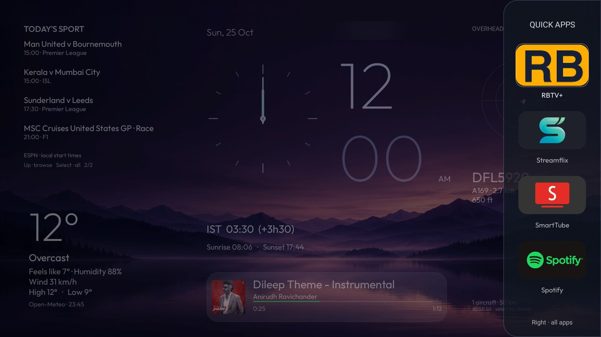
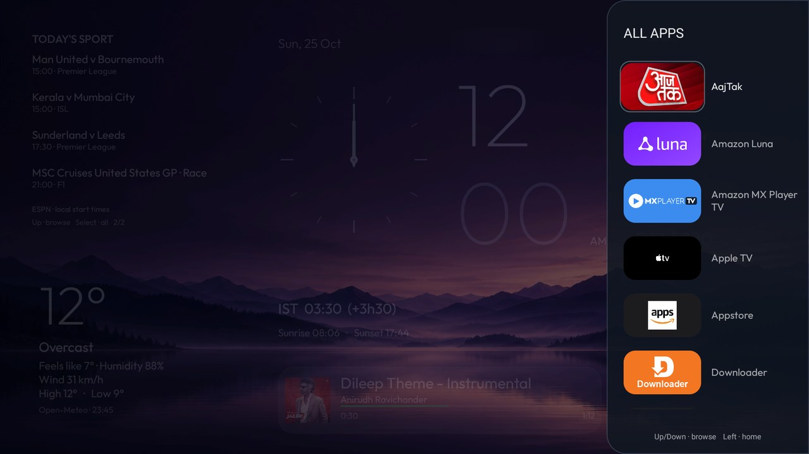
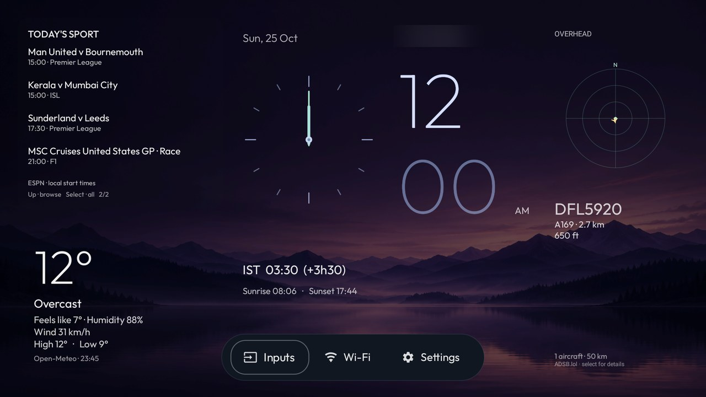

# Violet Horizon: design and Firestick Lite compatibility report

## Tested scope

Violet Horizon is a widget-first dashboard and purple twilight visual theme for a separate Fire TV launcher. It grew from the Fire OS 7 port of **Fire TV Glass**, during a CleanYourTV setup. It requires this branch's source build; it is not a drop-in JSON theme for CleanYourTV's reference launcher.

| Item | Evidence |
|---|---|
| Hardware | Fire TV Stick Lite (2020), AFTSS / sheldon |
| OS | Android 9 / SDK 28; Fire OS 7.7.1.7 |
| Firmware | PS7717.5741N |
| Display | 1920 × 1080 capture; 960 × 540 dp layout |
| App | `com.ivantrj.glasslauncher.os7`, target SDK 30 |
| Tools | JDK 17; SDK platform 35 / build-tools 35.0.0 |
| Session | 24–25 October 2026; one physical device |

This establishes a working result on one Lite/firmware combination, not every Fire OS 7 device. The same-session debloat choices and private configuration are not distributed as a new device list. This launcher does not root, flash, uninstall or disable Amazon Home.

## Compatibility fix and contribution route

Compatibility work selects an Android 9 minimum SDK and separate package, adds an app-grid entry for testing before Home redirection, narrowly matches Amazon Home window events, and supplies native Settings/Live TV fallbacks. The earlier offline compatibility contribution is separately reviewable in [Fire TV Glass PR #3](https://github.com/ivantrj/firetv-glass-launcher/pull/3).

The dashboard adds network feeds, optional media-session access and a substantial restyle. CleanYourTV explicitly routes that scope to a fork plus **SHOWCASE.md**. Its contribution therefore adds only a project link, tested-device summary, screenshot link and brand-index entry, with matching showcase counts. It changes no core permission, launcher default, protected package, safety script or CI workflow.

## Design and real-TV gallery

**Violet Horizon** names the quiet purple sky and low mountain/lake horizon. Important text sits over dark smooth areas. The AI-generated wallpaper and its prompt are supplied; the earlier downloaded landscape used during experiments is not redistributed.

Small 24 dp outer margins use the display edges. Sport replaces the old upper-left greeting/city block; compact weather sits below it. Weather/radar have no box background or rectangular focus border. Large local/analog clocks stay central, with date, India time and small sunrise/sunset details.

## Weather, clocks and greeting

Weather includes temperature, feels-like, condition, humidity, wind and daily high/low. Sunrise/sunset sit beside the clocks. Approximate coordinates and local timezone are read from a private file, with no automatic geolocation. India time uses `Asia/Kolkata`; the bracketed difference uses both zones' offsets at the current instant, correctly following local daylight-saving changes.

The idle music area shows `GOOD MORNING/AFTERNOON/EVENING/NIGHT BOYS` in local time, changing at 05:00/12:00/18:00/22:00. It disappears while Spotify plays and while the settings capsule covers that area.

## Sport and scores

Indian Super League, Premier League, UEFA Champions League and F1 events are filtered to today's local calendar day. Individual UTC-day requests cover that entire day, including 23/25-hour DST days; duplicate events are removed. F1 expands the weekend into individual sessions rather than using its opening timestamp as the race start.

Four events fit per page. Pages rotate every ten seconds while sport is not selected. Up from weather selects sport and pauses rotation; Up/Down browses pages; Select opens the complete scrollable schedule. Start times are local; unknown times say TBA. Finished/live football shows home/away goals beside the fixture, retaining real 0–0 but leaving upcoming/missing/invalid scores blank. Status is provider-reported. Updates are about every two minutes, not instantaneous streaming.

A failed competition is named as unavailable, rather than presented as an empty successful schedule. Coverage and future schedules are provider-dependent. Football fixtures, scores and F1 sessions appeared on the real TV. At local midnight, the card advanced to the next day's events during capture ([additional Home capture](images/home.jpg)).

## Radar and Spotify

The north-up radar shows airborne positions within 50 km, excluding positions older than 90 seconds, missing coordinates, invalid distances and non-positive altitudes. It shows the nearest aircraft and opens further details on Select. Community ADS-B coverage varies; this is an information widget, not a navigation/safety system.

Spotify provides embedded album art, title, artist and progress through local Android media sessions. Select opens Spotify. Short titles stay still; overflowing titles scroll using cached whole-pixel rendering to reduce shimmer. Paused/stopped music returns the greeting. There is no Spotify account token, lyrics/artwork request or Web API call.

The optional notification-listener grant is broad at OS level. The service implements connection callbacks, not notification-content parsing; the media observer filters Spotify and registers callbacks only while Home is started. It is separately reversible.

## Navigation and translucent panels

Right moves across widgets, then reveals four configured fixed favorites. Another Right opens a 240 dp-wide app drawer on the 960 dp canvas. Up/Down browses smaller app banners. Left/Back closes panels; Home and app return reset to the information dashboard. This is not usage-statistics recents and requests no usage-access permission.

The dock tint is about 72% opaque and the full drawer about 88%, with progressively dimmer widgets behind them. Wallpaper remains visible. There is no runtime blur. Rows clip to their viewport to avoid painting over the header/footer. Held Right does not skip both opening stages; Up/Down repeats keep browsing.

Down reveals a single opaque rounded pill behind Inputs, Wi-Fi and Settings. Right selects among its controls. Music/greeting text hides while that pill is present, preventing fragments around the edges. Menus open above it to fit on screen.

Screenshots show existing apps on the test TV. The public fallback dock retains upstream defaults; private overrides define the four favorites. No streaming app is bundled/installed or content endorsed.

## Static wallpaper and optional gradients

The included PNG is copied to private `files/wallpaper.png`; Android applies a dark filter without changing the original. A valid wallpaper hides/pauses `FlowingBackground`. Renaming/removing custom wallpapers restores gradients after reload.

Without wallpaper, embedded Spotify art supplies a music palette; otherwise the selected app supplies colors. Gradients render a small texture at a limited frame rate and stop when Home is stopped. Current screenshots use static wallpaper. This publication makes no benchmark or frame-rate improvement claim.

## Data and permission disclosure

| Destination / permission | Purpose |
|---|---|
| `api.open-meteo.com` | Weather approximately every 10 minutes on Home; configured approximate coordinates/timezone sent |
| `api.adsb.lol` | Aircraft approximately every 30 seconds on Home; configured approximate coordinates sent |
| `site.api.espn.com` | Fixtures/scores approximately every 2 minutes on Home; dates/competition identifiers sent |
| `INTERNET`, `ACCESS_NETWORK_STATE` | Public requests and a generic connection indicator |
| Optional accessibility | Matched Amazon Home window events; no key filtering/window-content retrieval |
| Optional notification-listener access | Media-session access; Android's broad grant is disclosed, notification contents are not parsed |

Providers receive normal connection metadata, including public IP. Weather/radar also receive the intentionally configured coordinates. No analytics SDK, ads, developer telemetry endpoint, automatic location lookup or account-login flow is present. Requests have timeouts and response-size limits. Periodic work stops when Home stops; an in-flight request may finish. Sports cancels remaining feed requests after stopping. Media metadata/artwork is not sent to these feeds.

Private location/configuration, Wi-Fi names, account emails, device identifiers, ADB/signing keys, backups, settings dumps, logs and APKs are excluded. Public screenshots are resized actual TV captures with city labels blurred. Their private originals are not uploaded. Existing MIT/OFL notices are retained.

## Validation

The installed customized build passed **50 Java checks**, lint with **zero errors** and APK assembly. Public source is independently rebuilt before publication. Groups: 8 Home-policy boundaries; 6 local/India DST checks; 15 panel transitions; 13 event-day/greeting checks; 8 score cases. Seven inherited Python fake-device setup/undo tests are retained and rerun for packaging.

TV captures verify widgets, football scores/F1 sessions, Spotify artwork/progress, fixed dock, scrolling drawer and settings pill. The owner confirmed physical Home returned from the drawer before the current Spotify capture. Remote/casting were confirmed earlier in setup. A full streaming-app regression suite was not performed. Reboot/Home was checked for the earlier OS 7 helper; no new cold-boot result is claimed for the final visual revision.

## Known limits

- Home return takes about five seconds on the tested Fire OS 7 build; Amazon Home can appear temporarily. No claim of removing that delay is made.
- The firmware blocks direct third-party Display & Sounds launches. Use the physical remote's native Home/Settings menu. Other shortcuts may vary by firmware.
- Configure your own location, timezone, wallpaper and installed-app favorites. No test location is baked in.
- ESPN public endpoints are undocumented and can change/omit events. Updates are periodic, not a live score stream.
- Optional notification/accessibility controls may be hidden by Fire OS. Enable knowingly, with separate undo steps.
- Layout is tuned to 960 × 540 dp. Other font scales, languages, devices and firmware are untested.
- No final memory-pressure, power, long-duration reliability or performance benchmark is claimed. The development build has 45 lint warnings; zero errors does not mean warning-free.

## Reproduce and recover

Use [INSTALL.md](INSTALL.md), build with your own key, keep backups, test the app before enabling Home, and check the physical remote. Amazon Home stays enabled. Undo removes only this helper and preserves other accessibility services; revoke notification access separately. Close ADB, revoke authorization and reboot after setup. Widgets/Home do not require ADB running.

Code additions are MIT; the font retains OFL, and third-party data/artwork retain their terms. Sources: [Open-Meteo docs](https://open-meteo.com/en/docs), [ADSB.lol API](https://api.adsb.lol/docs), [ESPN scoreboards](https://www.espn.com/soccer/scoreboard), [wallpaper provenance](../../assets/violet-horizon-prompt.md).

## Public source packaging verification

The clean, generic public checkout was rebuilt independently on Windows: all 50 Java checks, lint and assembly passed, with 0 lint errors and 45 warnings. All seven fake-device setup/undo tests passed. No private keystore or location file was needed. The public APK was build-checked, not installed over the owner's configured device.

The CleanYourTV contribution changes only SHOWCASE.md and its matching README project count. All 38 showcase-specific tests passed. The full repository suite was attempted on Windows, but shell-dependent cases could not complete successfully in this environment; it is not reported as a passing full suite. Linux CI remains required for the upstream project.

Public build APK SHA-256 (source verification only; APK not uploaded): `01ea16d436d7b2a1593c48ecbb06f92d1872197292c54c183b8b662fd68c15f9`.
